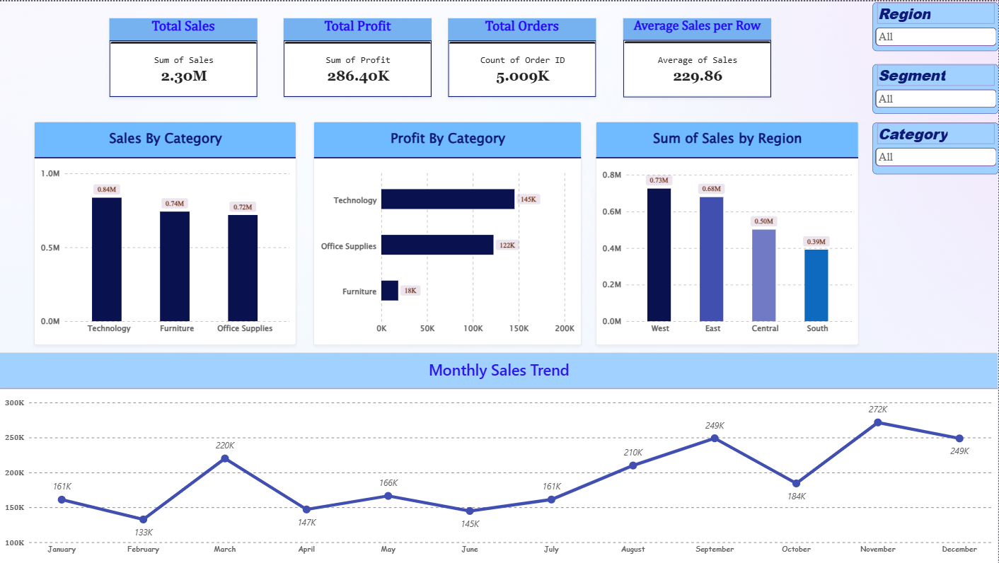

# Superstore Sales Analysis

## 1. Project Overview
This project analyzes Superstore sales data using Microsoft Power BI to understand sales performance, profitability, customer orders, and regional trends.

## 2. Project Objectives
- Analyze overall sales and profit.
- Compare sales across product categories.
- Identify the most profitable category.
- Compare regional sales performance.
- Analyze monthly sales trends.

## 3. Dataset
- Dataset: Superstore Dataset
- Total Records: 9,994
- Total Columns: 21
- Source: [Kaggle – Superstore Dataset](https://www.kaggle.com/datasets/vivek468/superstore-dataset-final)

## 4. Data Cleaning
Data preparation was performed using Power Query in Power BI.

- Checked column data types.
- Converted Postal Code to Text.
- Checked missing and empty values.
- Checked duplicate records.
- Reviewed numerical ranges for Sales, Profit, Discount, and Quantity.
- Loaded 9,994 records into Power BI.

## 5. Dashboard KPIs

| Metric | Result |
|---|---:|
| Total Sales | 2.30M |
| Total Profit | 286.40K |
| Total Orders | 5.009K |
| Average Sales per Row | 229.86 |

## 6. Dashboard Visualizations
- Sales by Category – Clustered Column Chart
- Profit by Category – Clustered Bar Chart
- Sales by Region – Clustered Column Chart
- Monthly Sales Trend – Line Chart
- Interactive slicers for Region, Category, and Segment

## 7. Key Insights
- Technology has the highest sales among the three categories.
- Technology also has the highest profit.
- West is the highest-performing region in sales.
- The dashboard allows interactive filtering by Region, Category, and Segment.

## 8. Tools Used
- Microsoft Power BI Desktop
- Power Query
- Microsoft Excel

## 9. Project Status
Completed – Version 1.0
## Dashboard Preview

